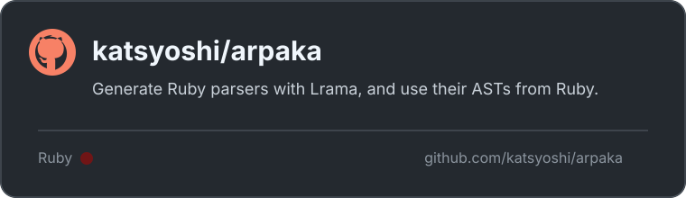

[](https://github.com/katsyoshi/arpaka)

[前回](/blog/2026/10/18/arpaka-extension-for-lrama/)は _パーサージェネレーター_ を使って
_parser_ を作るための準備し、構築する流れをみていきました。
今回は実際に _parser_ を作っていきます。というか _parser_ を吐き出すようにします。
**Lrama** の基本的な動作については、[かねこさん](https://github.com/yui-knk) の
[Ruby Parser開発日誌 (5)](https://yui-knk.hatenablog.com/entry/2023/03/13/101951) などに詳しいので、
ここでは Ruby の Parser を組み立てるときに必要になる Action の話をします。

## Rubyででてこないわけ

これも [Ruby Parser開発日誌 (6)](https://yui-knk.hatenablog.com/entry/2023/04/04/190413) などに詳しく書かれています。
結論からいうと出力される **C ファイル** に _parser_ と _lexer_ が密結合しており分離する
ことが困難で分割できないと。
分離した上で **Ruby** に置き換える意味は薄い、というのは私見です。

## Parse できる

まずは Lrama に簡単な文法を渡して、生成した _Parser_ で token 列を解析します。
電卓の文法なら、`NUMBER` と演算子の token 列を渡して、Action の結果として計算値を
返せます。

```ruby
parser_class = Lrama::Ruby.compile(File.read("examples/calculator.y"),
  filename: "examples/calculator.y", class_name: "Calculator")
parser = parser_class.new
parser.parse([[:NUMBER, 2], ["+", nil], [:NUMBER, 3], ["*", nil], [:NUMBER, 4]])
# => 14
```

この時点で、Lrama の解析表と Ruby の Parser は動いています。Parser に渡している
のはすでに token になった値なので、ここではまだ Ruby のソースを読んでいません。

## Actionとはなにか

文法の規則に付いている `{ ... }` が **Action** です。_Parser_ は規則に合う
_token_ を見つけると、その規則の Action を実行します。文法は「どの並びを
受け付けるか」を決め、Action は「受け付けたものから何を作るか」を決めます。

たとえば電卓の文法なら、次のような規則を書きます。

```yacc
expression: NUMBER { $$ = $1 }
          | expression '+' expression { $$ = $1 + $3 }
```

`$1` や `$3` は規則の右辺で得た値、`$$` はこの規則から返す値です。規則だけ
でも入力を受け付けるかは決められますが、解析結果を組み立てるには Action が必要です。

Ruby の `parse.y` では、Action は結果を作るだけではありません。`while` の
規則で `COND_PUSH(1)` を呼ぶように、Lexer の状態を更新する Action もあります。
その状態によって、Lexer が後の `do` をどの token として返すかが変わります。
この Parser と Lexer の状態のやり取りについては、[Ruby Parser開発日誌 (6)]
(https://yui-knk.hatenablog.com/entry/2023/04/04/190413) に詳しく書かれています。

つまり、Lrama が文法から解析表を作れたとしても、Ruby の `parse.y` に書かれた
C の Action をそのまま Ruby の _Parser_ で動かすことはできません。Ruby のビルド側に
ある Action の展開と、その周辺の Parser/Lexer の処理まで含めて対応する必要が
あります。これが、Ruby Parser を作るために Action の移植だけでは足りない理由です。

## Mottekuru Bubunn

### Action を持ってくる

Ruby Parser を Ruby で動かすために、まず Ruby の Parser 実装を持ってくることに
しましょう。最初は素朴に、`parse.y` に書かれている Action を Ruby 側へ持って
くるところから始めます。

Lrama の汎用バックエンドが作ってくれるのは、文法から作った解析表と、それを
動かす _Parser_ です。[最初の実装](https://github.com/katsyoshi/arpaka/commit/13c091c)
では、`Lrama::Ruby.compile` に文法を渡し、呼び出し側が `[token, value]` の列を
渡していました。これは電卓のような小さな文法を動かすには十分ですが、Ruby の
ソースを読むには Lexer と値を組み立てる処理が必要です。

### Action だけでは parse できない

でも、Action だけを移植しても Ruby のソースは parse できません。Ruby の
ビルド時に Action から生成される C コードは、Parser や Lexer の状態、C のマクロ、
補助関数などと結び付いています。Action は文法ファイルの中だけで完結していません。

そこから中を掘っていくと、Ruby のビルド側が Action をどのように展開しているか、
Lexer がどの token を返すか、reduce の結果をどのように組み立てるかまで確認する
必要があることが分かります。`parse.y` だけで Parser を作れるようにする話は、
これらの部品を切り分けた次回の記事で扱います。

そこで Ruby の `parse.y` と Lexer の実装、
さらに [Ruby ソースから standalone frontend を生成する処理](https://github.com/katsyoshi/arpaka/commit/d91c60b)
を持ってきます。`parse.y` から
文法を読み込み、Ruby 側で必要になる Action は対応する Ruby の処理へ置き換えます。
さらに Lexer と Builder を組み合わせて、Parser だけでなく Ruby のソースを
token 列へ変換するところまで一つのフロントエンドにします。

ここで持ってくるのは Ruby の Parser を C のまま実行するためのファイルでは
ありません。Ruby の文法と token の対応を入力として使い、Lrama で解析表を作り、
Action と実行時の部品は Ruby で生成します。最終的には Parser、Lexer、Builder
を含んだ Ruby ファイルを出力します。

## Parse Ruby

まずは生成したフロントエンドを Ruby から読み込みます。

```ruby
require "arpaka"

frontend = Arpaka.compile(
  ruby_source: "/path/to/ruby",
  class_name: "RubyParser"
)

result = frontend.parse("a = 1\na + 2", filename: "example.rb")
p result
```

この `parse` は、最初の `Lrama::Ruby` のように token 列を直接渡すものでは
ありません。生成した Lexer が Ruby のソースを token 列へ変換し、Parser が
文法を適用し、Action と Builder が解析結果を組み立てます。ここでは結果の
データ構造ではなく、生成した `RubyParser` が Ruby のソースを受け取り、
一連の処理を通して結果を返せることを確認します。「Ruby の文法を Lrama に読ませる」
だけでなく、「Ruby のソースを Ruby のプログラムから parse する」入口になります。

生成したソースを保存したい場合は `Arpaka.generate` を使います。

```ruby
code = Arpaka.generate(
  ruby_source: "/path/to/ruby",
  class_name: "RubyParser"
)
File.write("ruby_parser.rb", code)
```

この段階のフロントエンドはまだ Ruby 全体を扱えるわけではありません。まずは
Action を Ruby へ移植し、Parser と Lexer を組み合わせて、Ruby の入力を
Ruby の処理へ渡す流れを通すところまでを目標にしています。

## まとめ

ということで、Ruby の `parse.y` を Lrama に読み込ませ、Ruby の文法から Parser を
生成できるようにしました。

さらに、作った Parser で Ruby のソースを読めるようにするため、`parse.y` に
書かれた Action を Ruby 側へ移植しました。ただ、Action の本文を単純に
書き換えるだけでは足りません。Ruby のビルドシステムに依存した Action の生成
コードや、Parser と Lexer 周辺の処理も移植する必要がありました。

文法を読み込めることと、Ruby のソースを parse できることの間には、Action と
その周辺の実装が必要でした。
